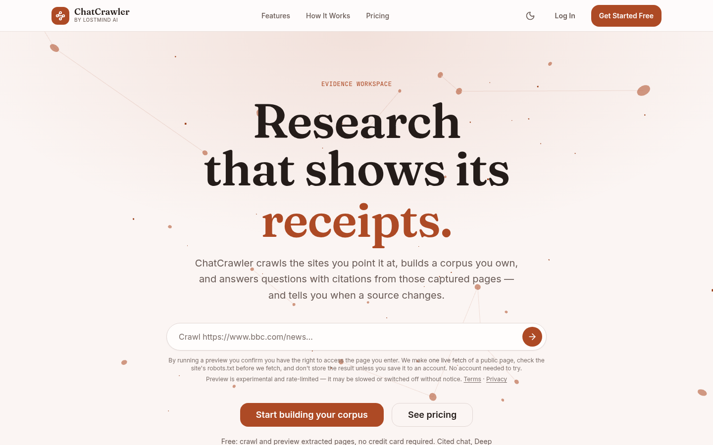
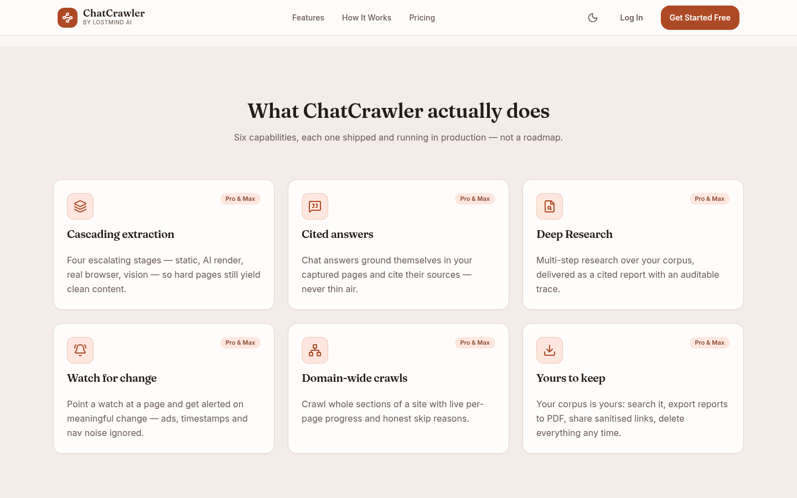
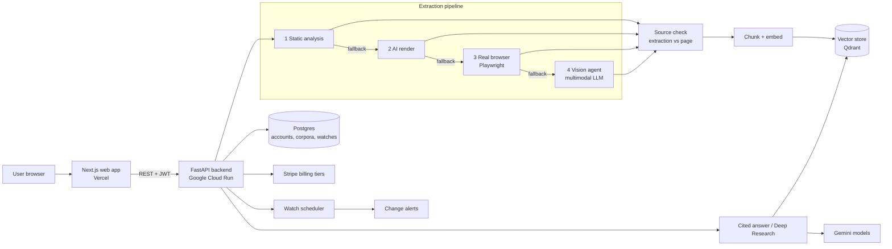

# ChatCrawler by LostMind AI

**An evidence workspace: research that shows its receipts.**

ChatCrawler crawls the sites you point it at, builds a corpus you own, answers questions with citations from those captured pages, and tells you when a source changes.

**Live:** [chatcrawler.lostmindai.com](https://chatcrawler.lostmindai.com) · **Company:** [www.lostmindai.com](https://www.lostmindai.com)

> This is a public showcase. The product source is private. Demo on request via [www.lostmindai.com](https://www.lostmindai.com).

## The problem it solves

General-purpose AI chat answers questions from whatever it was trained on, or from a quick web search it doesn't show you. For real research (product docs, policy pages, competitor sites, regulation), you need to know **which page an answer came from**, keep a copy of what that page said, and find out when it changes. ChatCrawler turns the pages you care about into a private, searchable corpus and only answers from that corpus, citing its sources.

## Key features

- **Cascading extraction.** Four escalating stages (static, AI render, real browser, vision), so hard pages still yield clean content.
- **Cited answers.** Chat answers are grounded in your captured pages and cite their sources.
- **Deep Research.** Multi-step research over your corpus, delivered as a cited report with an auditable trace.
- **Watch for change.** Point a watch at a page and get alerted on meaningful change. Ads, timestamps and navigation noise are ignored.
- **Domain-wide crawls.** Crawl whole sections of a site with live per-page progress and honest skip reasons.
- **Yours to keep.** Search your corpus, export reports to PDF, share sanitised links, and delete everything at any time.
- **Responsible crawling.** Checks robots.txt before fetching, rate limits crawls, and scans for personal information before storage.

## Architecture

Each extraction is compared with the source page to cut down on fabricated content. This is best effort, not a truth guarantee.

## Stack

| Layer | Technology |
|---|---|
| Frontend | Next.js (App Router), React, TypeScript, Tailwind |
| Backend | Python, FastAPI, on Google Cloud Run |
| Extraction | HTML analysis, AI rendering, Playwright, multimodal vision |
| Retrieval | Embeddings + Qdrant vector search |
| Models | Google Gemini family |
| Data | PostgreSQL |
| Billing | Stripe (free tier plus paid tiers) |
| Hosting | Vercel (web) + Google Cloud Run (API) |

## Plans

Free: crawl and preview extracted pages, no credit card required. Cited chat, Deep Research, domain-wide crawls and watch alerts are on paid plans. See [chatcrawler.lostmindai.com](https://chatcrawler.lostmindai.com) for current pricing.

## About

Built by [LostMind AI](https://www.lostmindai.com), Sydney, Australia.

Source is private. To see a demo or discuss a pilot, get in touch via [www.lostmindai.com](https://www.lostmindai.com).

© 2026 LostMind AI Pty Ltd. This repository contains documentation only. See [LICENSE](LICENSE).
