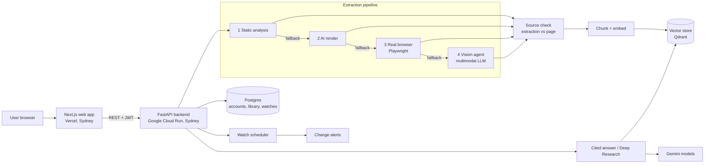

# ChatCrawler by LostMind AI

**Check and keep what AI tells you.**

ChatCrawler (free beta, still in testing) crawls the sites you point it at, builds a cited library you own, answers questions from those captured pages, and tells you when a source changes.

**Product:** [chatcrawler.lostmindai.com](https://chatcrawler.lostmindai.com) · **Company:** [www.lostmindai.com](https://www.lostmindai.com)

> This is a public showcase. The product source is private. ChatCrawler is a free beta and is still in testing. A demo is available on request via [www.lostmindai.com](https://www.lostmindai.com).

## The problem it solves

General-purpose AI chat answers questions from whatever it was trained on, or from a quick web search it doesn't show you. For real research (product docs, policy pages, competitor sites, regulation), you need to know **which page an answer came from**, keep a copy of what that page said, and find out when it changes. ChatCrawler turns the pages you care about into a private, searchable library and answers from that library, citing its sources.

## What is in the free beta

- **Chat and research with citations.** Answers are grounded in your captured pages and cite their sources. Deep Research produces a cited report with a trace you can review.
- **Cited library.** Search and keep the pages and files you have captured.
- **Deep crawls.** Crawl a site or a section of one, up to 500 pages, with live per-page progress and honest skip reasons.
- **Check sources from an uploaded file.** Upload a document that cites its sources and see which claims hold up against the live pages.
- **Background crawls.** A crawl can keep going after you leave the page.
- **Collections.** Group saved sources and chat or report from that set.
- **Site watches.** Point a watch at a page and get alerted on meaningful change. Ads, timestamps and navigation noise are ignored.
- **Cascading extraction.** Four escalating stages (static, AI render, real browser, vision), so hard pages still yield clean content.
- **Yours to keep.** Export reports to PDF, share a sanitised link, and delete your data from the product.
- **Responsible crawling.** Checks robots.txt before fetching, rate limits crawls, and scans for personal information before storage.

Paid plans and Stripe billing are not part of this beta. Everyone in the beta gets full access, with soft daily limits, and no credit card is required.

## Architecture

Each extraction is compared with the source page to cut down on fabricated content. This is best effort, not a truth guarantee.

## Stack

| Layer | Technology |
|---|---|
| Frontend | Next.js (App Router), React, TypeScript, Tailwind |
| Backend | Python, FastAPI, on Google Cloud Run (Sydney) |
| Extraction | HTML analysis, AI rendering, Playwright, multimodal vision |
| Retrieval | Embeddings + Qdrant vector search |
| Models | Google Gemini family |
| Data | PostgreSQL |
| Hosting | Vercel (web, Sydney) + Google Cloud Run (API, Sydney) |

## About

Built by [LostMind AI](https://www.lostmindai.com), Sydney, Australia.

Source is private. To see a demo, get in touch via [www.lostmindai.com](https://www.lostmindai.com).

© 2026 LostMind AI Pty Ltd. This repository contains documentation only. See [LICENSE](LICENSE).
